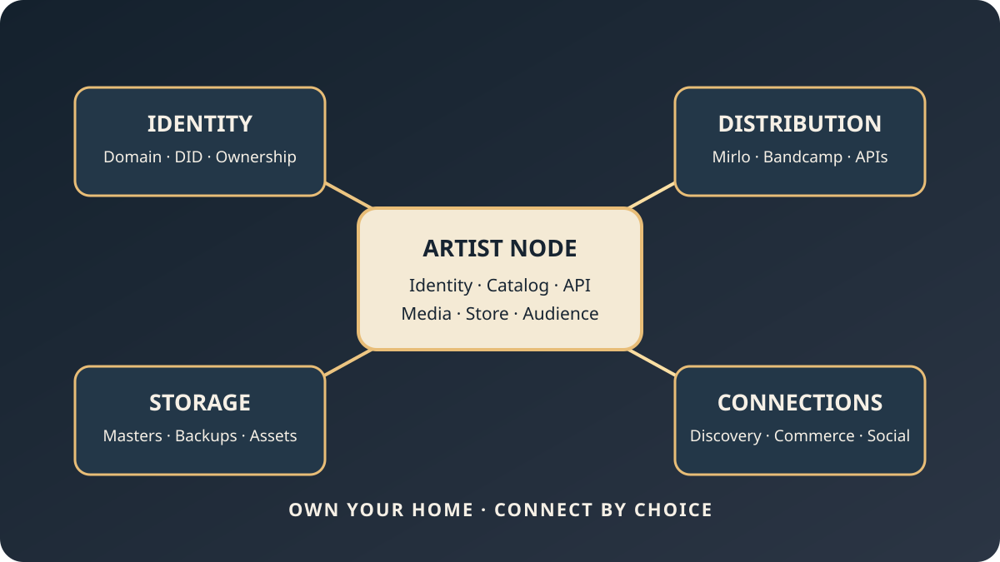

# Field Note 013: An Artist Should Be a Node, Not a Tenant

**November 23, 2026**  
*Independent distribution, interoperability, and the infrastructure behind creative ownership.*

An artist should be able to operate their own digital home—and connect to other systems without making those systems permanent dependencies.

That is the question behind our exploration of self-hosted music distribution, the AT Protocol, Personal Data Servers (PDS), and services such as [Mirlo](https://mirlo.space).

We are not proposing that every musician become a systems administrator. We are asking whether the infrastructure can be made modular enough that artists own their identity, catalog, media, storefront, and relationships while choosing which outside services help them reach listeners.

## The Artist Node

An Artist Node is a creator-controlled home for the parts of their digital operation that matter:

- Identity and domain
- Catalog, release metadata, credits, and artwork
- Audio masters and authorized delivery formats
- Storefront and distribution endpoints
- Audience relationships, mailing-list exports, and consent records
- Commerce integrations
- A documented API for other services

The artist could connect a music-discovery service, social network, payment processor, label workflow, or player through APIs and standards. Those connections should be optional, replaceable, and transparent.

## The PDS is a foundation—not the whole distribution stack

Our PDS investigation is about identity, repository ownership, portability, and participation in the Atmosphere. A PDS can support identity-linked records and blobs, but we should not assume it is the best place to serve an entire music catalog or large media files.

The artist's identity and catalog references could live in protocol-compatible records while the actual audio is delivered through artist-controlled storage, object storage, a distribution service, or a CDN. The system should make those boundaries clear and allow the artist to change providers.

**A portable identity. A catalog that can be read. Media that can be delivered. Services that can be replaced.**

## Mirlo as a point of investigation

[Mirlo](https://mirlo.space) is one of the existing projects worth studying rather than rebuilding by default. Its open-source music platform and catalog/API approaches offer a possible distribution component for an Artist Node.

We are interested in what an independent artist can actually operate today, what self-hosting requires, how catalog discovery and authorized streaming work across systems, and where the practical limits are.

This is research, not an endorsement or an assumption that Mirlo is the answer. A service should be evaluated on the artist's needs, operating costs, accessibility, interoperability, ownership, and exit path.

## The timing is practical

The final announced [Bandcamp Friday of 2026](https://daily.bandcamp.com/features/bandcamp-fridays) is **Friday, December 4**. These moments make the economics and infrastructure of independent distribution visible: artists and labels prepare releases, listeners decide where to spend, and the platforms involved shape the transaction.

We are not arguing that artists should abandon services that currently work for them. We are asking what the next step toward independence could look like—whether that is a self-hosted catalog, an API bridge, a different storefront, a shared infrastructure arrangement, or a combination.

## The case study, not the sales pitch

Loptr Lab can provide a working case study. We have a real creative ecosystem, an evolving set of requirements, and an interest in learning by deploying. We can test what is useful, document what is difficult, and evaluate costs and terms against our actual capacity.

Our strength may be in identifying the need, bringing a practical use case, and finding others who can make the missing pieces. We do not need to build everything ourselves to retain independence.

A partner or service should help us get what we need at a price and under terms we can afford. If it works, we can share the lessons. If it doesn't, our architecture should give us a way to change direction.

## Invitation to the people doing this already

Artists, independent distributors, open-source developers, self-hosters, and music platforms: we would welcome your perspective.

What are the real costs of operating independent distribution? Which parts are manageable today, and which still require a platform, a specialist, or a costly service? What interoperability exists in practice—not just in documentation? What would make a self-contained Artist Node useful rather than another burden?

We are especially interested in the realities behind the upcoming Bandcamp Friday: how artists prepare, where they send listeners, what they wish they owned or controlled, and what would make a portable, API-connected alternative genuinely useful.

**We are investigating—not announcing a product. The best next step may be a partnership, a pilot, an existing open-source project, or a case study that helps others make informed decisions.**

---

### Breadcrumbs

- [Atmosphere field guide](https://atmosphere.loptrlab.com/)
- [PDS Independence Kit](https://github.com/ibloud/pixie-device-stewardship/tree/main/tools/atmosphere-guide/pds-kit)
- [Mirlo](https://mirlo.space)
- [Mirlo on Bluesky](https://bsky.app/profile/mirlo.space)
- [Infrastructure Is a Business Decision — Field Note 012](https://atmosphere.loptrlab.com/)

*No sponsorship, affiliate relationship, referral commission, or promotional obligation to Mirlo, Bandcamp, or any hosting provider. This is an independent field note documenting an ongoing investigation.*
